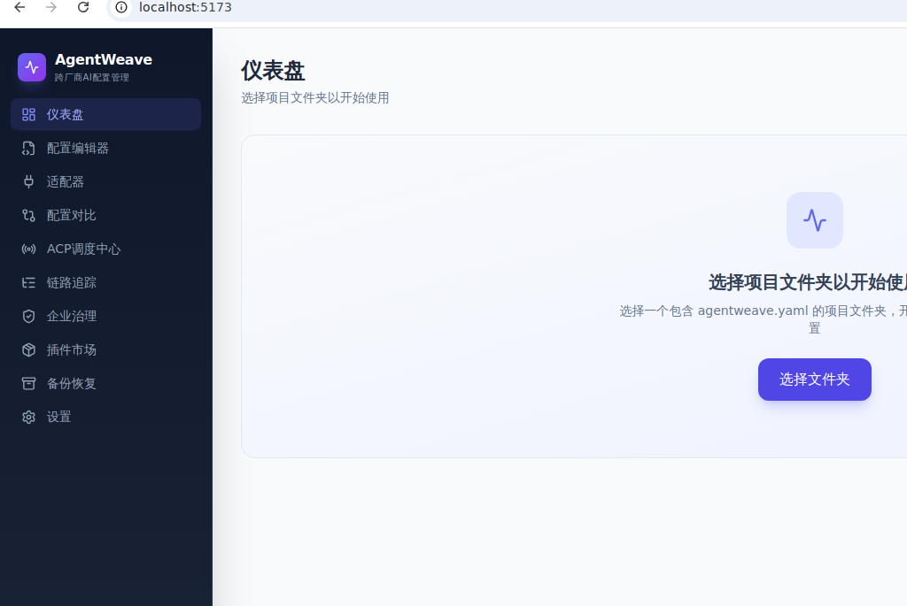
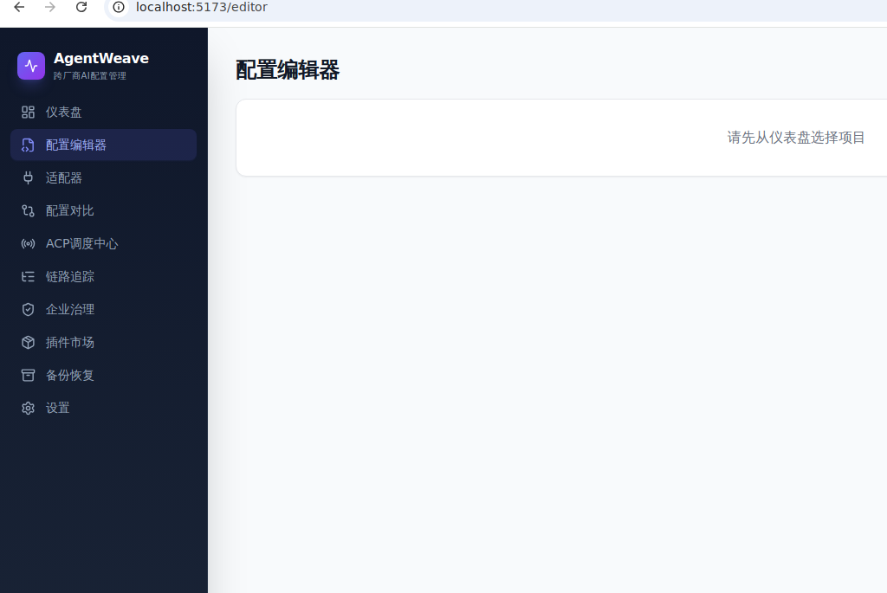
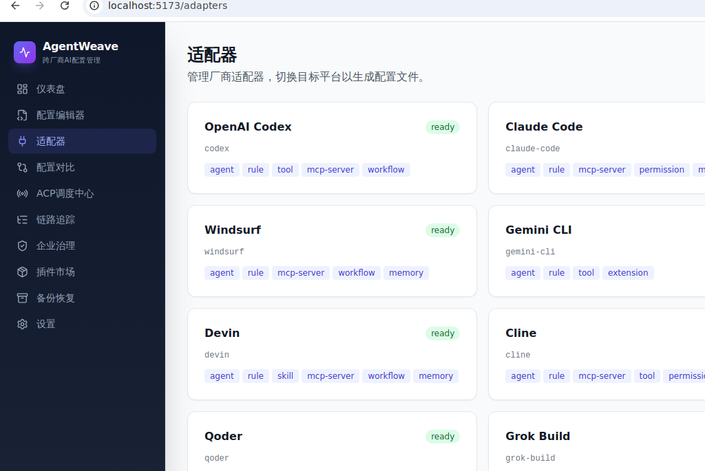
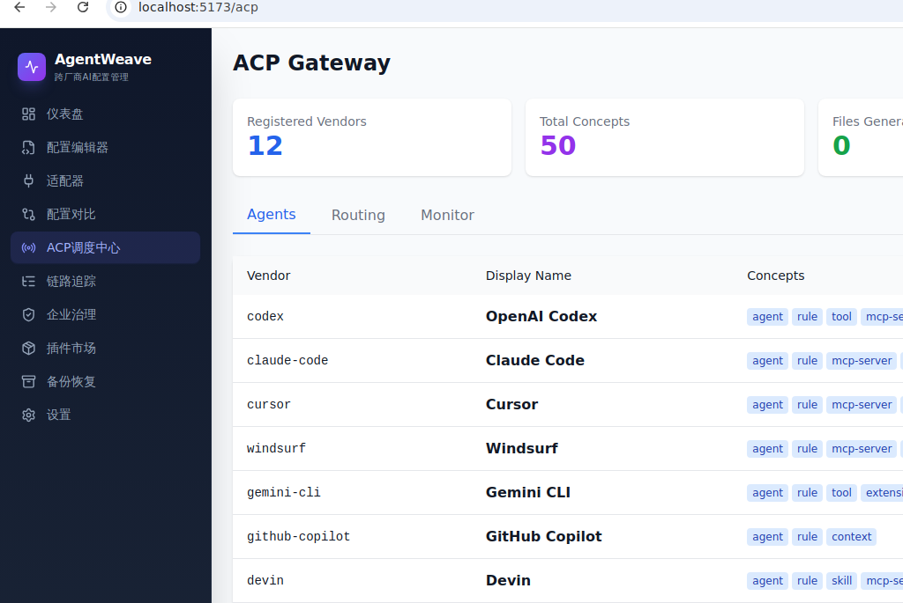
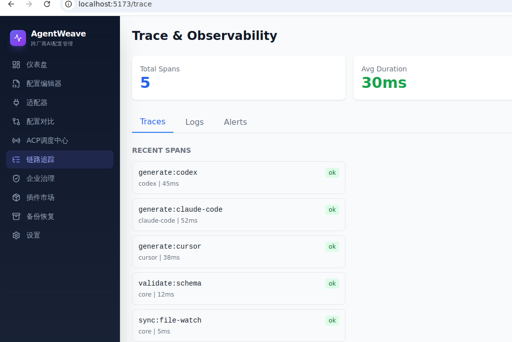
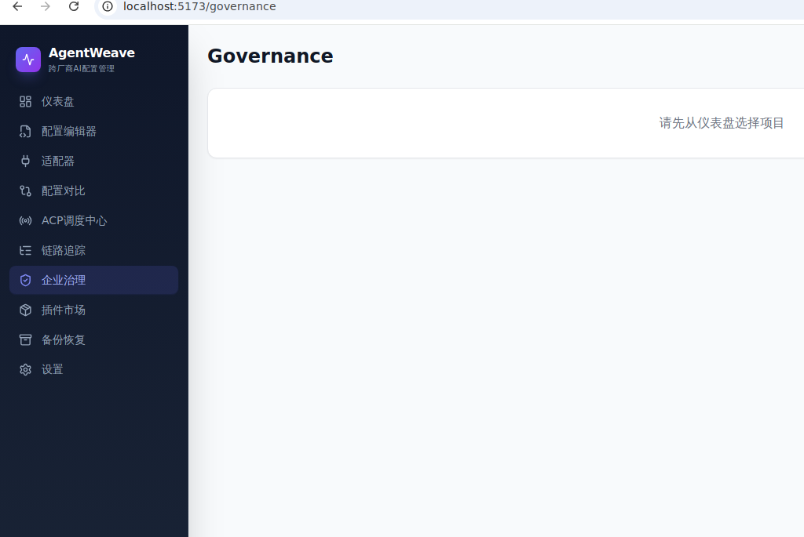
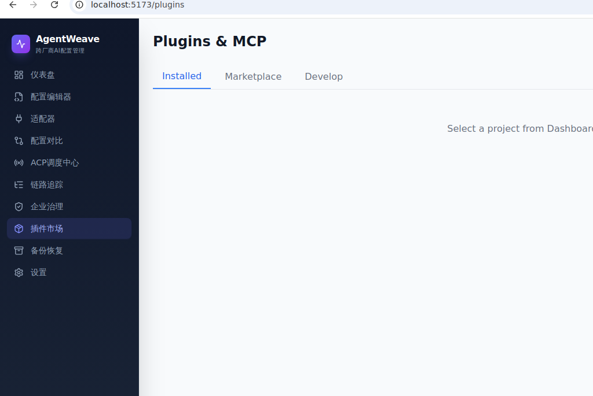
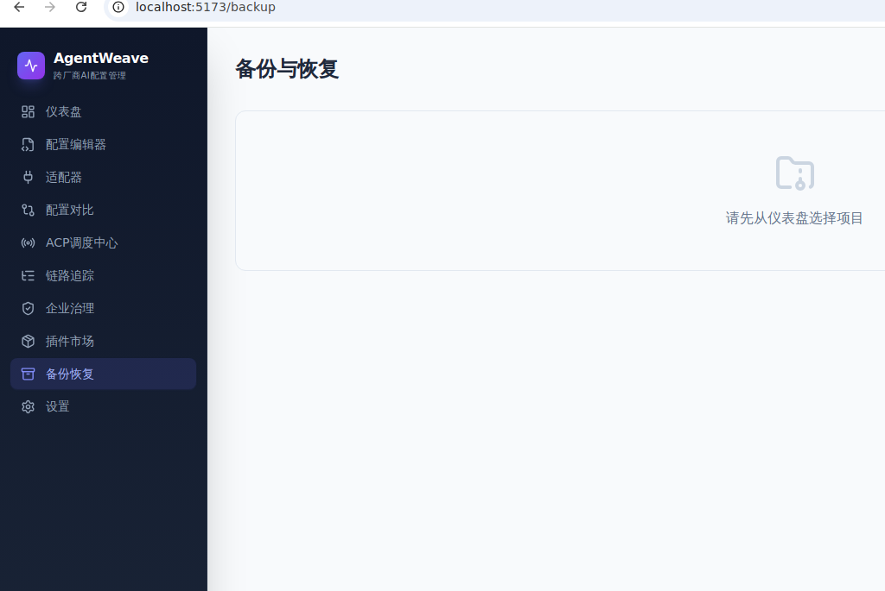
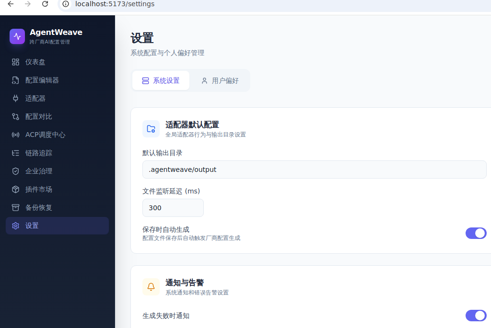
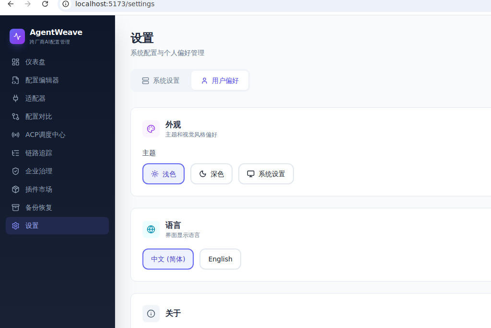

# AgentWeave

<p align="center">
  <strong>跨厂商统一智能体配置管理平台</strong><br>
  <em>Unified Cross-Vendor AI Agent Configuration Management</em>
</p>

<p align="center">
  <a href="#features">Features</a> •
  <a href="#quick-start">Quick Start</a> •
  <a href="#supported-vendors">Vendors</a> •
  <a href="#architecture">Architecture</a> •
  <a href="#documentation">Docs</a> •
  <a href="README_zh-CN.md">中文文档</a>
</p>

---

## Overview

AgentWeave defines a **superset specification** for AI agent configuration and provides a complete toolchain to:

- **Define once, generate for all** — Write a single configuration, output for 12+ vendors
- **Seamless migration** — Switch between AI coding tools without reconfiguring
- **Real-time sync** — Multiple IDEs sharing one config with live synchronization
- **Enterprise governance** — Full audit trail, RBAC, policy enforcement, cost monitoring
- **Cross-vendor observability** — Unified logging, tracing, and metrics across all vendors

## Features

| Category | Capabilities |
|----------|-------------|
| **Superset Spec** | 46 unified concepts covering agents, rules, skills, workflows, hooks, memory, MCP, and more |
| **Adapters** | Codex, Claude Code, Cursor, Windsurf, Gemini CLI, GitHub Copilot, Devin, Cline, CodeBuddy, Qoder, Grok Build, OpenClaw |
| **ACP Gateway** | Unified Agent Communication Protocol dispatch with routing, load balancing, circuit breaking |
| **Real-time Sync** | File-watch based sync across multiple IDEs with conflict resolution |
| **Tracing** | OpenTelemetry-compatible full-chain tracing with span visualization |
| **Version Control** | Git-based config versioning with diff, rollback, and tagging |
| **Remote Update** | Signed incremental updates with canary deployment |
| **i18n** | Multi-language support (zh-CN, en-US) |
| **Cross-platform** | macOS, Windows, Linux (Tauri desktop app + CLI) |

## Quick Start

### Installation

```bash
# Install CLI
cargo install agentweave-cli

# Or download pre-built binary
curl -fsSL https://agentweave.dev/install.sh | bash
```

### Initialize a Project

```bash
cd your-project
agentweave init --name "My Project"
```

This creates a `.agentweave/` directory with the superset configuration.

### Generate Vendor Configs

```bash
# Generate for all target vendors
agentweave generate

# Generate for a specific vendor
agentweave generate --vendor cursor
```

### Watch Mode (Real-time Sync)

```bash
agentweave watch
```

Edit `.agentweave/` files and all vendor configs auto-update.

## Supported Vendors

| Vendor | Config Format | Concepts Supported |
|--------|--------------|-------------------|
| OpenAI Codex | `AGENTS.md`, skills, MCP | Agent, SubAgent, Rule, Skill, Memory, MCP |
| Claude Code | `CLAUDE.md`, `.claude/`, `.mcp.json` | Agent, SubAgent, Rule, Skill, Workflow, Hook, Memory, MCP, Permission, OutputStyle |
| Cursor | `.cursor/rules/*.mdc` | Rule, Agent |
| Windsurf | `.windsurf/rules/` | Rule, Agent, Memory |
| Gemini CLI | `GEMINI.md`, `.gemini/settings.json` | Rule, Agent, Memory, MCP, Model |
| GitHub Copilot | `.github/copilot-instructions.md` | Rule, Agent |
| Devin | `.devin/`, `AGENTS.md` | Agent, SubAgent, Rule, Skill, Hook, MCP |
| Cline | `.clinerules/` | Rule, Agent |
| CodeBuddy | `.codebuddy/` | Agent, SubAgent, Rule, Skill, Hook, MCP, Permission, OutputStyle |
| Qoder | `/agents`, SDK | Agent, SubAgent, Tool |
| Grok Build | `.grok/config.toml` | Agent, Rule, Skill, Hook, MCP, Plugin |
| OpenClaw | `~/.openclaw/openclaw.json` | Agent, MultiAgent, Memory, Session, Model |

## Architecture

```
┌─────────────────────────────────────┐
│    Desktop App (Tauri + React)       │
├─────────────────────────────────────┤
│    Core Engine (Rust)                │
│  ┌─────────┐ ┌─────────┐ ┌───────┐ │
│  │ Schema  │ │Adapter  │ │ Sync  │ │
│  │Validator│ │ Engine  │ │Engine │ │
│  └─────────┘ └─────────┘ └───────┘ │
├─────────────────────────────────────┤
│    Vendor Adapters (pluggable)       │
│  Codex│Claude│Cursor│Windsurf│...   │
└─────────────────────────────────────┘
```

## Project Structure

```
AgentWeave/
├── crates/
│   ├── agentweave-core/       # Core engine (config, adapter trait, schema)
│   ├── agentweave-cli/        # CLI tool (init, generate, import, compare, serve)
│   ├── agentweave-acp/        # ACP Gateway (REST API, routing, health)
│   ├── agentweave-trace/      # Cross-vendor tracing + OTLP export
│   ├── agentweave-sync/       # Real-time file sync engine
│   ├── agentweave-governance/ # RBAC, policies, audit, quotas
│   ├── agentweave-updater/    # Remote update (checker, downloader, strategy)
│   └── adapters/              # 12 vendor adapters
├── apps/
│   └── desktop/               # Tauri v2 cross-platform desktop application
│       ├── src/               # React + TypeScript + Tailwind frontend
│       └── src-tauri/         # Rust backend (16 IPC commands, system tray)
├── packages/
│   ├── schema/                # JSON Schema definitions for IDE auto-completion
│   └── sdk/                   # Adapter development SDK documentation
├── examples/                  # Example configurations (minimal/fullstack/enterprise)
├── docs/                      # Documentation
│   ├── user-guide.md
│   ├── api-reference.md
│   └── architecture.md
└── .github/workflows/         # CI/CD (build + cross-platform release)
```

## Configuration Example

```yaml
# .agentweave/agentweave.yaml
apiVersion: agentweave/v1
kind: Project
metadata:
  name: "my-project"
  version: "1.0.0"

spec:
  defaultModel:
    provider: anthropic
    model: claude-sonnet-4

  targets:
    - codex
    - claude-code
    - cursor
    - windsurf
    - gemini-cli
    - github-copilot

  sync:
    mode: realtime
    transport: file-watch
```

## Desktop App

The cross-platform desktop application provides a visual interface for managing all AgentWeave features.

**Supported Platforms:** Linux (deb/AppImage), macOS (dmg), Windows (msi/exe)

### Dashboard

Project overview with health checks, quick actions, and real-time status.



### Config Editor

YAML configuration editor with syntax highlighting, validation, and multi-file tabs.



### Adapters (12 Vendors)

Manage all 12 vendor adapters — view supported concepts and generate configs individually or in batch.



### ACP Gateway

Unified Agent Communication Protocol dispatch — registered vendors, routing, and monitoring.



### Trace & Observability

Full-chain OTLP-compatible tracing with span visualization and performance metrics.



### Governance

Enterprise governance — policies, RBAC roles, audit trail, quotas, and compliance (SOC2/GDPR).



### Plugins & MCP

MCP server management — install, configure, and monitor MCP protocol servers.



### Backup & Restore

Full config ZIP export/import, snapshot backup, and version rollback.



### Performance A/B Testing

Run experiments comparing different agent configurations across vendors — track response time, accuracy, token usage, and success rate.

### Prompt Testing

Cross-vendor prompt behavior testing framework — define test cases, run across multiple vendors, compare outputs and pass rates.

### AI Assistant

AI-powered configuration suggestions with confidence scoring, plus conversational configuration Q&A.

### Config Analytics

Concept usage distribution, vendor coverage analysis, rule hit rates, and gap identification.

### Environment Management

Manage dev/staging/prod configuration variants — override specific fields per environment without affecting the baseline.

### Inheritance Visualization

Visualize the `extends` inheritance chain — see which configs inherit from where, field-level source tracking, and final resolved values.

### Settings (System / User separated)

System-level settings (adapter defaults, notifications, security) and user preferences (theme, language) in separate tabs.




### Development

```bash
cd apps/desktop
npm install
npm run tauri dev

# Build for production
npm run tauri build
```

## CLI Reference

| Command | Description |
|---------|-------------|
| `agentweave init` | Initialize project with `.agentweave/` scaffold |
| `agentweave generate [--vendor V]` | Generate vendor configs from superset |
| `agentweave validate` | Schema + semantic validation |
| `agentweave import <vendor>` | Reverse-import existing vendor config |
| `agentweave compare [--vendors V1,V2]` | Cross-vendor output comparison |
| `agentweave diff [from] [to]` | Show config diff between versions |
| `agentweave watch` | Real-time file monitoring + auto-regeneration |
| `agentweave sync [--mode M]` | Manual/realtime sync management |
| `agentweave vendors` | List supported vendors and capabilities |
| `agentweave status` | Show project and adapter status |
| `agentweave version <commit\|log\|restore>` | Config snapshot management |
| `agentweave serve [--port P]` | Start ACP REST gateway |
| `agentweave mcp <add\|list\|remove\|test>` | MCP server lifecycle management |
| `agentweave plugin <install\|list\|remove>` | Plugin/extension management |
| `agentweave secret <set\|list\|remove>` | Encrypted credential storage |
| `agentweave debug [--dry-run]` | Cross-vendor unified debugging |
| `agentweave health` | Environment health check |
| `agentweave export [--format F]` | Export config (yaml/json/markdown) |
| `agentweave completions <shell>` | Generate shell completions |
| `agentweave daemon [--port P]` | Background daemon (watch + sync + serve) |

## Schema System

AgentWeave provides a comprehensive schema system for IDE auto-completion, validation, and interoperability:

| Format | File | Purpose |
|--------|------|---------|
| JSON Schema | [`packages/schema/agentweave.schema.json`](packages/schema/agentweave.schema.json) | IDE autocomplete, programmatic validation |
| XML Schema | [`packages/schema/xml/agentweave.xsd`](packages/schema/xml/agentweave.xsd) | XML tooling, enterprise integration |
| Examples | [`packages/schema/examples/`](packages/schema/examples/) | Minimal + complete configs (YAML/JSON/XML) |
| Specification | [`docs/spec/schema-specification.md`](docs/spec/schema-specification.md) | Concept catalog, extensibility model |

### Extensibility

- **`x-*` fields** — Vendor-specific extensions (e.g. `x-cursor`, `x-claude`)
- **`custom:` vendors** — Register new vendors without code changes
- **`extends`** — Configuration inheritance (local or remote)
- **`kind: Fragment`** — Reusable partial configurations

## Documentation

- [User Guide](docs/user-guide.md) — Installation, workflow, configuration reference
- [API Reference](docs/api-reference.md) — CLI commands and ACP gateway endpoints
- [Architecture](docs/architecture.md) — System design and component overview
- [Schema Specification](docs/spec/schema-specification.md) — 46+ concepts, extensibility, governance, versioning
- [Superset Schema](docs/spec/superset-schema.md) — Full concept catalog
- [Adapter Protocol](docs/spec/adapter-protocol.md) — SDK for building new adapters
- [Quick Start Guide](docs/guides/quick-start.md) — Get running in 5 minutes
- [Enterprise Governance](docs/guides/enterprise-governance.md) — RBAC, policies, audit
- [Desktop App Guide](docs/guides/desktop-app.md) — UI walkthrough
- [Adapter SDK](packages/sdk/README.md) — Build custom adapters
- [Schema Package](packages/schema/README.md) — JSON/XML Schema + examples
- [Changelog](CHANGELOG.md) — Version history

## Roadmap

All planned features have been implemented (v0.1.0):

| Priority | Feature | Status |
|----------|---------|--------|
| P0 | **Conflict Resolution UI** — 3-way merge visualization | Done |
| P0 | **Template Marketplace** — Community-shared templates | Done |
| P0 | **Team Collaboration** — Multi-user shared config with locking | Done |
| P1 | **Config Validation Preview** — Dry-run with diff per vendor | Done |
| P1 | **Performance A/B Testing** — Cross-vendor config comparison | Done |
| P1 | **Migration Wizard** — Step-by-step guided migration | Done |
| P1 | **Context Window Optimizer** — Token limit optimization | Done |
| P2 | **Cost Dashboard** — API usage tracking and budget alerts | Done |
| P2 | **Prompt Testing Framework** — Cross-vendor behavior testing | Done |
| P2 | **Config Linting Rules** — Custom lint rules | Done |
| P2 | **Webhook Integrations** — Slack/Teams/Discord notifications | Done |
| P3 | **AI-Assisted Config** — AI-powered configuration suggestions | Done |
| P3 | **Config Analytics** — Usage stats, coverage gaps, hit rates | Done |
| — | **Environment/Variant Management** — dev/staging/prod configs | Done |
| — | **Inheritance Visualization** — extends chain + resolved values | Done |
| — | **Concept Dependency Graph** — Agent→MCP→Rule visual graph | Done |

### Future Roadmap (v0.2.0+)

| Feature | Description |
|---------|-------------|
| **Plugin SDK** | Third-party adapter development framework |
| **Cloud Sync** | Cross-device configuration synchronization |
| **Multi-tenant** | SaaS mode with org/team/project isolation |
| **CI/CD Integration** | GitHub Actions / GitLab CI config generation hooks |
| **IDE Extensions** | VS Code / JetBrains plugin for inline editing |
| **Config Diff Timeline** | Git-like timeline of all config changes |

## Contributing

See [CONTRIBUTING.md](CONTRIBUTING.md) for development setup and contribution guidelines.

## License

MIT License - see [LICENSE](LICENSE) for details.
