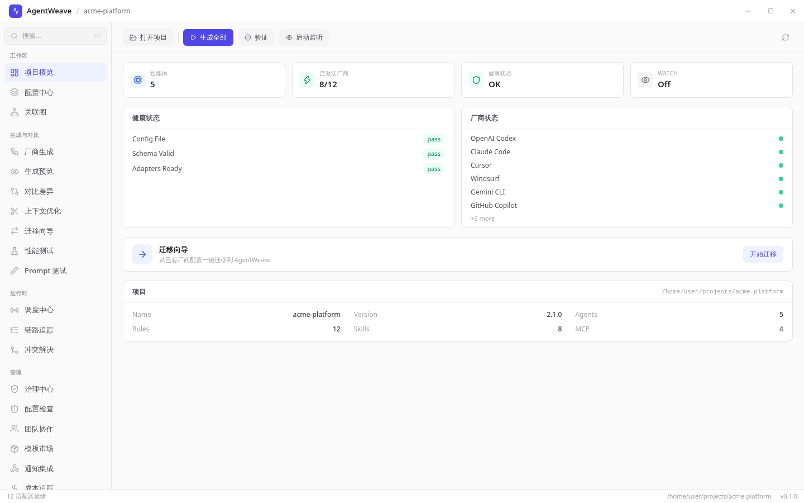
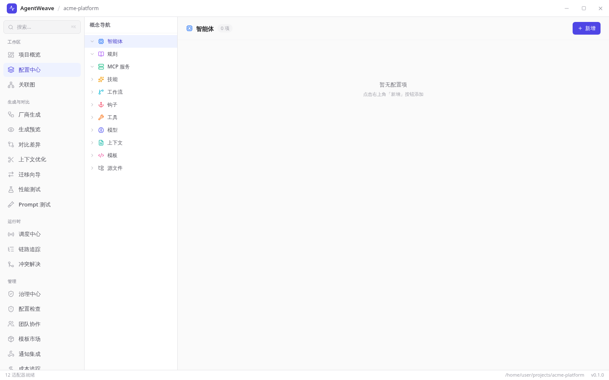
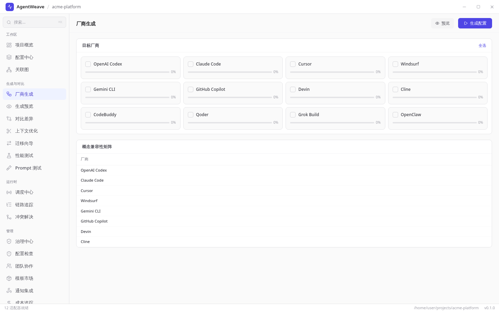
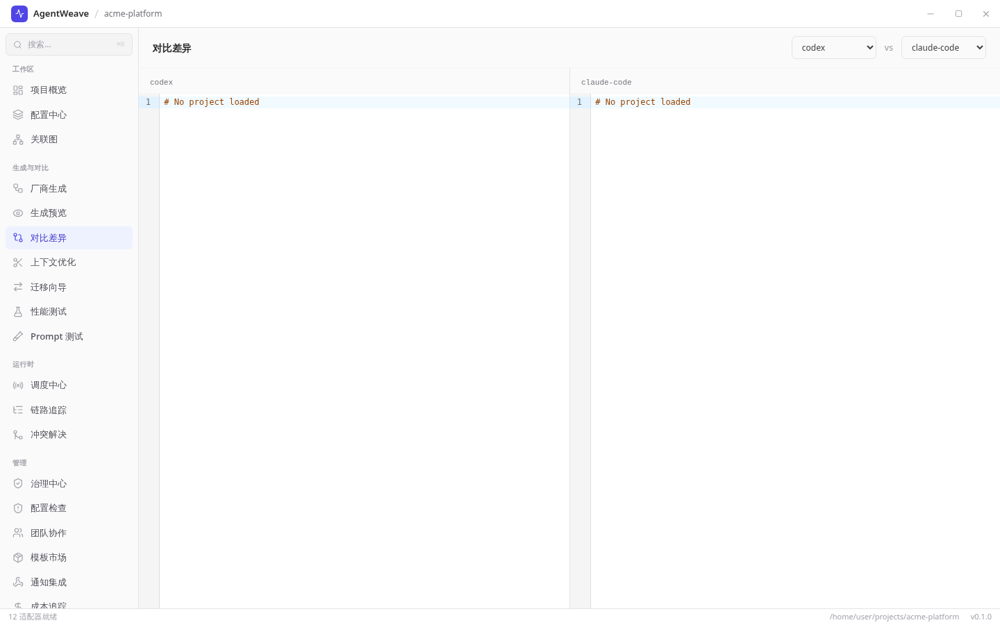
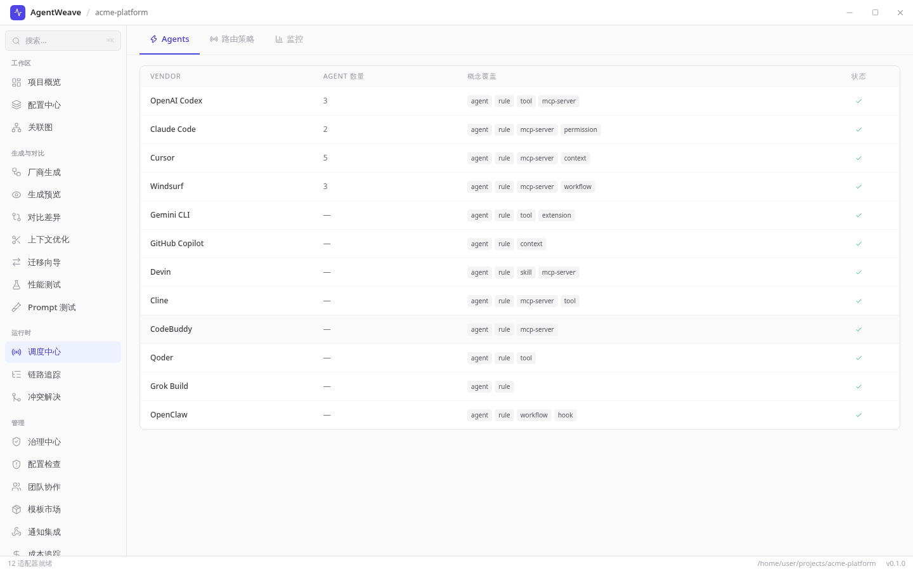
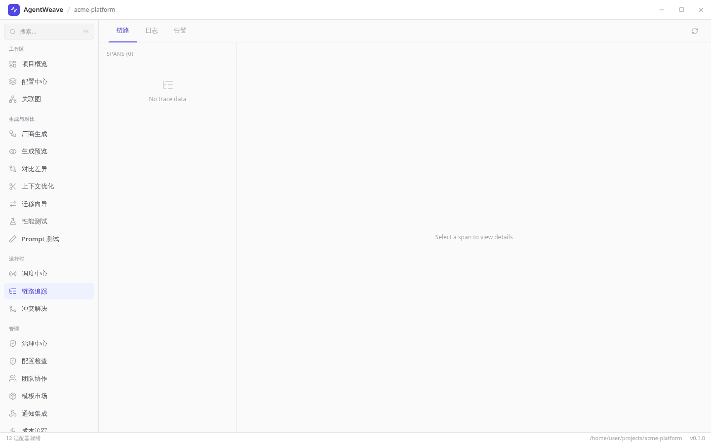
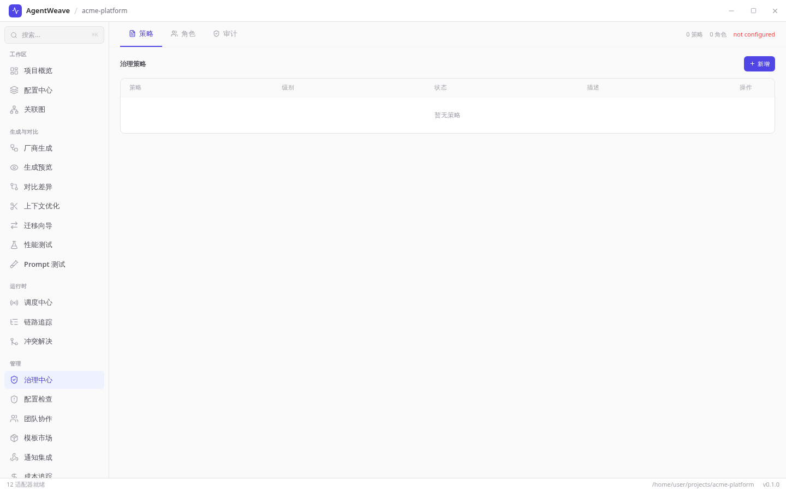
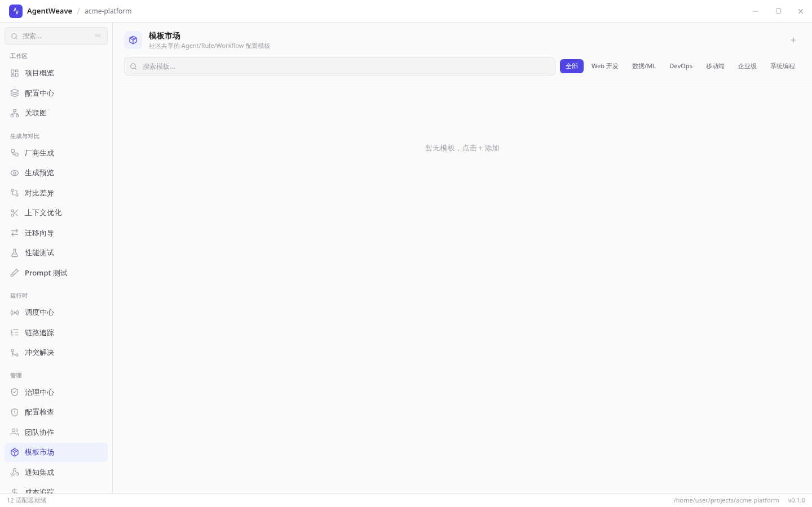
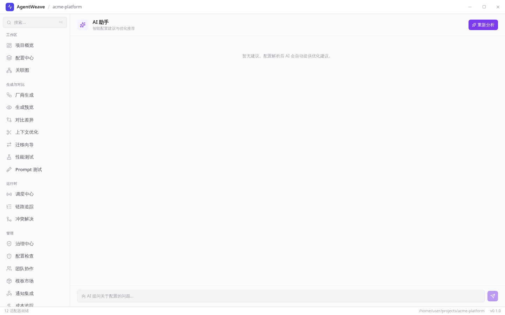
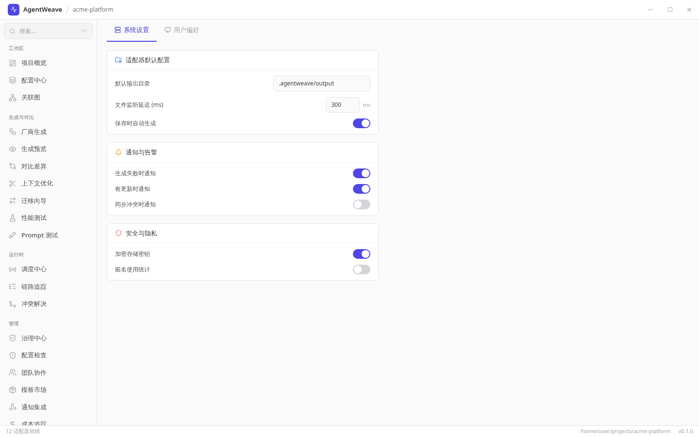

# AgentWeave

<p align="center">
  <strong>跨厂商 AI 智能体统一配置管理平台</strong><br>
  <em>定义一次，生成全部 — 无缝迁移 AI 开发工具</em>
</p>

<p align="center">
  <a href="#功能特性">功能</a> •
  <a href="#快速开始">快速开始</a> •
  <a href="#支持厂商">厂商</a> •
  <a href="#架构设计">架构</a> •
  <a href="#文档">文档</a> •
  <a href="README.md">English</a>
</p>

---

## 概述

AgentWeave 定义了一套 **AI 智能体配置超集规范**，并提供完整工具链：

- **一次配置，全部生成** — 编写一份配置，输出到 12+ 厂商
- **无缝迁移** — 在 AI 编码工具间切换，无需重新配置
- **实时同步** — 多个 IDE 共享同一配置，实时同步
- **企业治理** — 完整审计追踪、RBAC 角色控制、策略执行、成本监控
- **跨厂商可观测性** — 统一日志、追踪、指标

## 功能特性

| 类别 | 能力 |
|------|------|
| **超集规范** | 46+ 统一概念：智能体、规则、技能、工作流、Hook、记忆、MCP 等 |
| **适配器** | Codex, Claude Code, Cursor, Windsurf, Gemini CLI, GitHub Copilot, Devin, Cline, CodeBuddy, Qoder, Grok Build, OpenClaw |
| **ACP 网关** | 统一智能体通信协议调度，路由、负载均衡、熔断 |
| **实时同步** | 基于文件监听的跨 IDE 同步 + 冲突解决 |
| **全链路追踪** | OpenTelemetry 兼容，Span 可视化 |
| **版本管理** | 基于 Git 的配置版本控制 (diff/rollback/tag) |
| **远程更新** | 签名增量更新 + 金丝雀发布 |
| **多语言** | 中文 / English |
| **跨平台** | macOS / Windows / Linux (Tauri 桌面端 + CLI) |

## 快速开始

### 安装

```bash
# 从源码安装 CLI
cargo install --path crates/agentweave-cli

# 或下载预编译二进制
curl -fsSL https://github.com/gatesenman/AgentWeave/releases/latest/download/agentweave-linux-x86_64.tar.gz | tar xz
sudo mv agentweave /usr/local/bin/
```

> 目前 [Releases](https://github.com/gatesenman/AgentWeave/releases) 页面还没有发布版本，预编译二进制下载暂不可用，请先从源码安装。

### 初始化项目

```bash
cd your-project
agentweave init --name "我的项目"
```

生成 `.agentweave/` 目录，包含超集配置。

### 生成厂商配置

```bash
# 生成所有目标厂商的配置
agentweave generate

# 为特定厂商生成
agentweave generate --vendor cursor
```

### 监听模式（实时同步）

```bash
agentweave watch
```

编辑 `.agentweave/` 文件后自动更新所有厂商配置。

## 支持厂商

| 厂商 | 配置格式 | 支持概念 |
|------|---------|---------|
| OpenAI Codex | `AGENTS.md`, skills, MCP | Agent, SubAgent, Rule, Skill, Memory, MCP |
| Claude Code | `CLAUDE.md`, `.claude/`, `.mcp.json` | Agent, SubAgent, Rule, Skill, Workflow, Hook, Memory, MCP, Permission |
| Cursor | `.cursor/rules/*.mdc` | Rule, Agent, MCP Server, Context, Model |
| Windsurf | `.windsurf/rules/` | Rule, Agent, MCP Server, Workflow, Memory |
| Gemini CLI | `GEMINI.md`, `.gemini/settings.json` | Rule, Agent, Tool, Extension |
| GitHub Copilot | `.github/copilot-instructions.md` | Rule, Agent, Context |
| Devin | `.devin/`, `AGENTS.md` | Agent, Rule, Skill, MCP Server, Workflow |
| Cline | `.clinerules/` | Rule, Agent, MCP Server, Tool, Permission |
| CodeBuddy | `.codebuddy/` | Agent, Rule, MCP Server |
| Qoder | `/agents`, SDK | Agent, Rule, Tool |
| Grok Build | `.grok/config.toml` | Agent, Rule |
| OpenClaw | `~/.openclaw/openclaw.json` | Agent, Rule, Workflow, Hook |

## CLI 命令参考

| 命令 | 说明 |
|------|------|
| `agentweave init` | 初始化项目配置 |
| `agentweave generate` | 从超集生成厂商配置 |
| `agentweave validate` | Schema + 语义校验 |
| `agentweave import <vendor>` | 从已有厂商配置反向导入 |
| `agentweave compare` | 跨厂商输出对比 |
| `agentweave diff` | 版本间差异对比 |
| `agentweave watch` | 实时监听 + 自动重新生成 |
| `agentweave sync` | 同步管理（手动/实时） |
| `agentweave vendors` | 列出支持的厂商 |
| `agentweave status` | 项目状态 |
| `agentweave version` | 配置快照管理 |
| `agentweave serve` | 启动 ACP REST 网关 |
| `agentweave mcp` | MCP Server 管理 |
| `agentweave plugin` | 插件管理 |
| `agentweave secret` | 加密凭证存储 |
| `agentweave debug` | 跨厂商统一调试 |
| `agentweave health` | 环境健康检查 |
| `agentweave export` | 配置导出 |
| `agentweave completions` | Shell 自动补全 |
| `agentweave daemon` | 后台守护进程 |

## 架构设计

```
┌─────────────────────────────────────────┐
│     桌面应用 (Tauri + React + TS)         │
├─────────────────────────────────────────┤
│     核心引擎 (Rust)                       │
│  ┌──────────┐ ┌──────────┐ ┌─────────┐ │
│  │ Schema   │ │ Adapter  │ │  Sync   │ │
│  │ 校验器    │ │  引擎     │ │  引擎   │ │
│  └──────────┘ └──────────┘ └─────────┘ │
├─────────────────────────────────────────┤
│     厂商适配器 (可插拔)                    │
│  Codex│Claude│Cursor│Windsurf│...12家    │
├─────────────────────────────────────────┤
│  ACP网关 │ 全链路追踪 │ 企业治理 │ 远程更新 │
└─────────────────────────────────────────┘
```

## 技术栈

| 层 | 技术 |
| --- | --- |
| 核心 / CLI / 网关 | Rust 2021（Cargo workspace）、serde / serde_yaml / serde_json、tokio、anyhow / thiserror |
| 桌面后端 | Tauri 2（系统托盘、`plugin-fs`、`plugin-dialog`、`plugin-notification`） |
| 桌面前端 | React 18、TypeScript、Vite、Tailwind CSS、Zustand、React Router、i18next、CodeMirror（YAML） |
| Schema | JSON Schema（`packages/schema/agentweave.schema.json`） |
| CI | GitHub Actions（`.github/workflows/ci.yml`、`release.yml`） |

## 项目结构

```
AgentWeave/
├── crates/
│   ├── agentweave-core/       # 核心引擎（配置、适配器 trait、Schema）
│   ├── agentweave-cli/        # 命令行（init、generate、import、compare、serve）
│   ├── agentweave-acp/        # ACP 网关（REST API、路由、健康检查）
│   ├── agentweave-trace/      # 跨厂商追踪 + OTLP 导出
│   ├── agentweave-sync/       # 实时文件同步引擎
│   ├── agentweave-governance/ # RBAC、策略、审计、配额
│   ├── agentweave-updater/    # 远程更新（检查、下载、策略）
│   └── adapters/              # 12 个厂商适配器
├── apps/
│   └── desktop/               # Tauri v2 跨平台桌面应用
│       ├── src/               # React + TypeScript + Tailwind 前端
│       └── src-tauri/         # Rust 后端（IPC 命令、系统托盘）
├── packages/
│   ├── design-system/         # 共享 UI 设计组件（npm workspace）
│   ├── schema/                # JSON Schema 定义（IDE 自动补全）
│   └── sdk/                   # 适配器开发 SDK
├── examples/                  # 配置示例（minimal / fullstack / enterprise）
├── tests/e2e/                 # 端到端测试（Cargo workspace 成员）
├── locales/                   # 共享多语言文件
├── docs/                      # 文档
└── .github/workflows/         # CI/CD（构建 + 跨平台发布）
```

## 配置示例

```yaml
# .agentweave/agentweave.yaml
apiVersion: agentweave/v1
kind: Project
metadata:
  name: "my-project"
  version: "1.0.0"

targets:
  - codex
  - claude-code
  - cursor
  - windsurf

agents:
  - name: architect
    role: 资深软件架构师
    tools: [read_file, write_file, terminal]
    instructions: |
      遵循项目编码规范，编写清晰、可测试的代码。

rules:
  - name: code-style
    scope: always
    content: 使用 TypeScript，遵循 ESLint 规则。

governance:
  policies:
    - name: model-whitelist
      type: allowlist
      values: [claude-sonnet-4, gpt-4.1]
```

## 桌面应用

跨平台桌面应用提供可视化管理界面。

**支持平台：** Linux (deb/AppImage), macOS (dmg), Windows (msi/exe)

> 下面的截图按当前代码重新实拍，界面语言为中文。截图来自前端的浏览器开发模式（在 `apps/desktop` 里运行 `pnpm dev`，用无头 Chromium 打开）：这种模式下 Vite 会把 Tauri API 换成仓库自带的 `src/mocks/`，并打开示例项目 `acme-platform`。追踪、治理、模板市场、AI 助手这几页的数据存在本地 SQLite 里，所以这里显示的是空状态，桌面应用里会显示你自己的数据。英文界面的同一组截图见 [README.md](README.md)。

### 仪表盘

项目概览、健康检查、快捷操作、迁移向导、配置检测。



### 配置中心

概念树导航（Agents、Rules、MCP、Skills、Workflows、Hooks、Tools、Models）+ 卡片式详情。



### 厂商生成

12 厂商多选 + 概念兼容性矩阵 + 批量生成。



### 跨厂商对比

厂商输出并排对比，文件差异可视化。



### ACP 网关

统一智能体通信协议调度 — 注册厂商、路由策略、监控。



### 全链路追踪

OTLP 兼容全链路追踪，Span 列表、延迟分析。



### 企业治理

策略管理、RBAC 角色、审计日志、配额控制。



### 模板市场

社区模板浏览、搜索、分类、一键下载。



### AI 助手

AI 智能配置建议 + 对话式优化 + 代码 diff 预览。



### 设置

系统设置（适配器默认、通知、安全）+ 用户偏好（主题、语言）。



## Schema 系统

| 格式 | 文件 | 用途 |
|------|------|------|
| JSON Schema | [`agentweave.schema.json`](packages/schema/agentweave.schema.json) | IDE 自动补全、程序化校验 |
| XML Schema | [`agentweave.xsd`](packages/schema/xml/agentweave.xsd) | XML 工具链、企业集成 |
| 示例 | [`examples/`](packages/schema/examples/) | 最小 + 完整配置 (YAML/JSON/XML) |
| 规范 | [`schema-specification.md`](docs/spec/schema-specification.md) | 概念目录、扩展性模型 |

### 扩展性设计

- **`x-*` 字段** — 厂商特定扩展（如 `x-cursor`, `x-claude`）
- **`custom:` 厂商** — 注册自定义厂商，无需修改代码
- **`extends` 继承** — 配置深度合并（本地或远程）
- **`kind: Fragment`** — 可复用配置片段

## 文档

- [用户指南](docs/user-guide.md) — 安装、工作流、配置参考
- [API 文档](docs/api-reference.md) — CLI 命令、ACP 网关接口
- [架构概览](docs/architecture.md) — 系统设计、组件说明
- [Schema 规范](docs/spec/schema-specification.md) — 46+ 概念、扩展性、治理、版本策略
- [超集概念目录](docs/spec/superset-schema.md)
- [适配器协议](docs/spec/adapter-protocol.md) — SDK 开发指南
- [快速入门](docs/guides/quick-start.md)
- [企业治理](docs/guides/enterprise-governance.md)
- [桌面应用指南](docs/guides/desktop-app.md)
- [变更日志](CHANGELOG.md)

## 开发

```bash
# 克隆仓库
git clone https://github.com/gatesenman/AgentWeave.git
cd AgentWeave

# 构建所有 Rust crate
cargo build --workspace

# 运行测试
cargo test --workspace

# 运行 CLI
cargo run -p agentweave-cli -- --help

# 开发桌面端
cd apps/desktop
npm install
npm run dev          # 浏览器开发模式
npm run tauri dev    # Tauri 桌面开发模式
```

## 贡献

详见 [CONTRIBUTING.md](CONTRIBUTING.md)。

## 许可证

MIT License - 详见 [LICENSE](LICENSE)。
