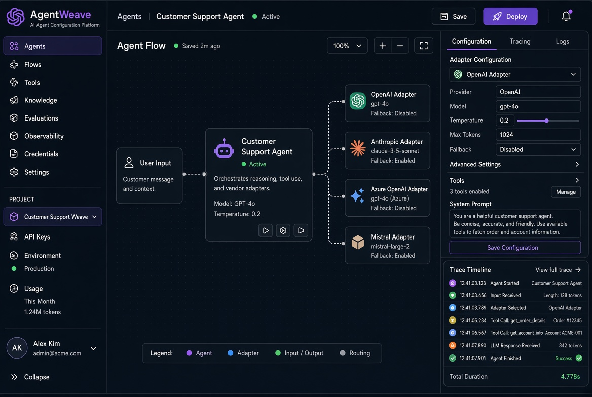

# AgentWeave 文档中心

AgentWeave 是跨厂商 AI Agent 配置管理平台，提供统一超集规范（46+ 概念）、12 个厂商适配器、桌面应用（Tauri + React）、ACP 运行时与全链路追踪。

## 界面预览

## 核心特性

- 统一 Agent 配置规范
- 多厂商适配器（OpenAI、Anthropic 等）
- 可视化 Agent 流程编排
- 全链路追踪与可观测性
- 桌面端一键部署

## 文档导航

- [架构概览](Architecture.md)
- [适配器开发](Adapters.md)
